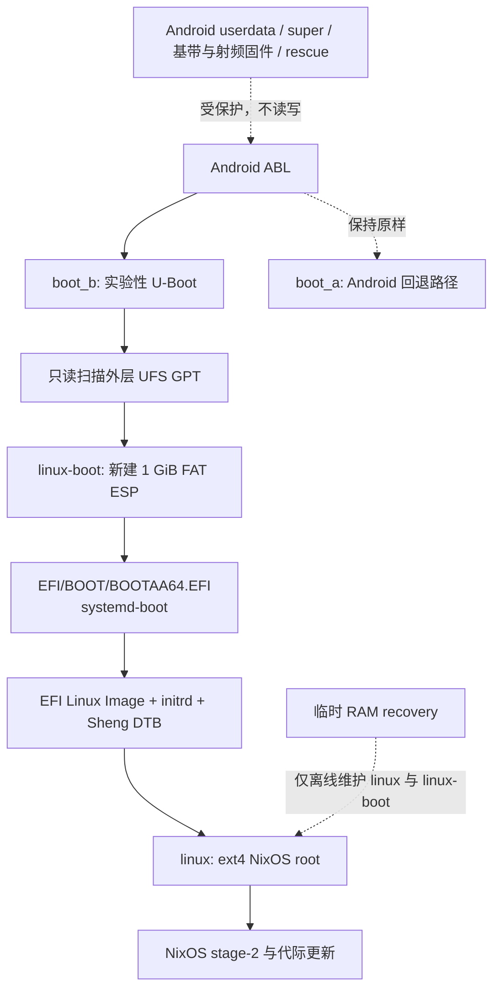

# Sheng U-Boot / EFI 存储迁移预案

> 状态：存储准备阶段已完成实机验收。`linux-boot` 是独立的 1 GiB FAT32 ESP，稳定 Mobile NixOS 已从缩小后的 `linux` 根分区进入 stage-2。EFI 载荷已部署，7.3.0 候选已完成 B 槽持久启动、普通重启和刷回；关机插线、冷启动和恢复键仍待验收。本文不是刷机教程，也不能直接用于修改 GPT。

## 目标启动架构

`boot_b` 只在 U-Boot 实验阶段临时替换；失败时恢复已知可启动的 Mobile NixOS `boot_b` 即可回到现有启动链。
`boot_a` 和所有 Android 固件分区始终不在实验写入集内。

## 初始布局与已验证的目标布局

外层 UFS GPT 使用 4 KiB 逻辑扇区，表项容量为 32，当前已有 30 个分区。Android
`userdata` 是 `sda29`（F2FS），现有 NixOS 根是 `sda30`（ext4，GPT 名为 `linux`）：

| 分区 | 起始 LBA | 大小（LBA） | 角色 |
| --- | ---: | ---: | --- |
| `userdata` | 3,094,784 | 40,533,248 | Android F2FS，保留 |
| `linux` | 43,628,032 | 20,379,131 | NixOS ext4 根，保留 |

准备前，`linux` 恰好延伸至磁盘最后一个可用 LBA（64,007,162），因此没有空闲空间，也没有可以安全复用的 FAT ESP：

- `uefi_a`/`uefi_b` 是小型设备固件分区；
- `rescue` 保存 Android update engine、恢复和关机充电日志；
- `logfs`、调制解调器、蓝牙分区均属于 Android 固件链路。

2026-10-11 的 RAM recovery 实际只从 `linux` **末尾**释放了 1 GiB。Android `userdata`、`super`、A/B
槽位与所有固件分区均未写入。当前已验证布局如下：

只从 `linux` 的**末尾**离线释放 1 GiB，不改变 `userdata`、`super`、A/B 或任何固件分区。4 KiB
扇区下 1 GiB 为 262,144 个 LBA，目标如下：

| 分区 | 起始 LBA | 大小（LBA） | 格式/用途 |
| --- | ---: | ---: | --- |
| `linux` | 43,628,032 | 20,116,987 | ext4 根，缩小 1 GiB |
| `linux-boot`（新 `sda31`） | 63,745,019 | 262,144 | GPT ESP、FAT32、挂载到 `/boot` |

该 ESP 使用标准 EFI GPT 类型 GUID `c12a7328-f81f-11d2-ba4b-00a0c93ec93b`，FAT 标签为 `linux-boot`，FAT UUID
为 `B9D7-707A`，分区 UUID 为 `a9ecf033-04ea-40c3-b9ef-79df0a758f35`。正常系统的
`systemd-gpt-auto-generator` 已将它以 `nodev,nosuid,noexec,nosymfollow` 挂载到 `/boot`；首次验证时该文件系统为空，
现已部署经 SHA-256 校验的 EFI 载荷。

U-Boot 按 GPT 名 `linux-boot` 查找该分区，并读取 `EFI/BOOT/BOOTAA64.EFI`。systemd-boot 的 Type #1 条目包含
内核、initrd、DTB；它不包含 rootfs、Android 镜像或固件分区内容。

## 实机验收记录

执行前的全盘 GPT 备份已保存到主机，SHA-256 为
`22b99acd1b885facf1beaf2e4250873deccd87eb55aee4d3359975b01373d85c`。完成后，`sfdisk --verify /dev/sda`
通过；`linux` 的 ext4 UUID 保持为 `ee8d3593-59b1-480e-a3b6-4fefb17ee7d8`，状态为 `clean`，块数为
`20,116,987`，块大小为 4096。

恢复已知可启动的 `boot_b` 后，设备运行内核 `7.1.8` 并进入 NixOS stage-2，根目录仍由
`/dev/disk/by-partlabel/linux` 以 ext4 挂载，`systemctl --failed` 为空。该验收证明根分区缩容和 ESP 的 GPT/FAT
创建没有破坏现有 Mobile NixOS 启动链。后续 EFI 实机验证已确认 U-Boot 能加载此 ESP 中的 systemd-boot，EFI 内核
进入 stage-1 与 stage-2，且一次普通重启再次通过同一启动链。

## Android 保护边界

已执行的 recovery 脚本在写入前同时断言：

- 目标磁盘是 262,173,360,128 字节、4 KiB 扇区的 UFS `sda`；
- `linux` 的 GPT 名、起始 LBA `43,628,032`、原始大小 `20,379,131`、UUID
  `22c64e07-7a6d-4614-bbd3-a01fc1dcd4ec` 与 ext4 UUID 都精确匹配；
- `userdata`、`super`、`rescue`、`uefi_a`/`uefi_b`、modem、Bluetooth、`persist` 及所有 A/B
  固件分区不在命令参数中；
- `linux` 和新 ESP 均未被挂载，且 GPT 校验、ext4 只读检查、主机备份均成功。

任一条件不匹配即退出，不尝试“猜测”分区名、UFS 磁盘字母或扇区位置。

## 已完成的执行门槛

`linux` 约 77 GiB，已用约 68 GiB，可用约 9 GiB；容量上能够让出 1 GiB，但 ext4 不能在已挂载时缩小。以下门槛均已完成：

1. 构建并实机验证一个独立 RAM recovery，能在不挂载 `linux` 的情况下提供 ADB/USB 恢复和
   `e2fsck`、`resize2fs`、GPT 与 FAT 工具。
2. 在 recovery 中创建完整的 `sfdisk --dump` 备份和 `linux` 文件系统检查记录；先执行只读布局计划。
3. 获得用户对 1 GiB 根分区缩容的明确确认，并先验证新 GPT、ext4 与稳定系统启动，再格式化 ESP。

EFI 载荷已构建、离线写入临时 FAT32 并逐项读回校验，随后复制到 `/boot` 并在设备上逐文件 SHA-256 复核。
现有世代同步只为内核闭包与 EFI 载荷匹配的 NixOS profile 生成 Type #1 条目；
当前候选已通过第 1 世代实机启动。ESP 更新与回退边界见[EFI 实验记录](uboot-efi-experiment_zh.md)。

## 验收与回退

首次 EFI 启动只替换 `boot_b`，并保留稳定的 Android/NixOS boot 镜像。已完成的验收顺序为：GPT 可读、FAT
文件可读、U-Boot 加载 systemd-boot、EFI 内核进入 stage-1、根分区挂载、stage-2、B 槽成功标记与普通重启。

任何阶段失败均先回到 Android ABL fastboot，刷回已知可启动的 `boot_b`；在恢复环境中保留的原始 GPT
备份和 ext4 检查记录用于继续诊断。未完成所有验收前，不合并该实验分支，也不发布镜像。
