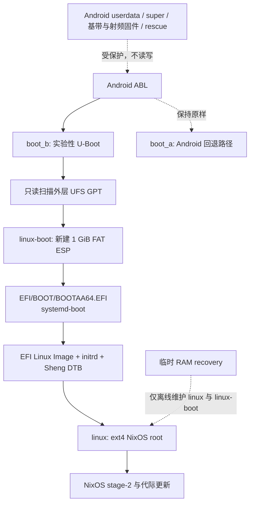

# Sheng U-Boot / EFI 存储迁移预案

> 状态：用户已授权该实验；GPT 写入仍被独立 RAM recovery、备份和离线验收门槛阻止。本文不是刷机教程，也不能直接用于修改 GPT。

## 目标启动架构

`boot_b` 只在 U-Boot 实验阶段临时替换；失败时恢复已知可启动的 Mobile NixOS `boot_b` 即可回到现有启动链。
`boot_a` 和所有 Android 固件分区始终不在实验写入集内。

## 已测得的现有布局

外层 UFS GPT 使用 4 KiB 逻辑扇区，表项容量为 32，当前已有 30 个分区。Android
`userdata` 是 `sda29`（F2FS），现有 NixOS 根是 `sda30`（ext4，GPT 名为 `linux`）：

| 分区 | 起始 LBA | 大小（LBA） | 角色 |
| --- | ---: | ---: | --- |
| `userdata` | 3,094,784 | 40,533,248 | Android F2FS，保留 |
| `linux` | 43,628,032 | 20,379,131 | NixOS ext4 根，保留 |

`linux` 恰好延伸至磁盘最后一个可用 LBA（64,007,162），因此当前没有空闲空间，也没有可以安全复用的 FAT ESP：

- `uefi_a`/`uefi_b` 是小型设备固件分区；
- `rescue` 保存 Android update engine、恢复和关机充电日志；
- `logfs`、调制解调器、蓝牙分区均属于 Android 固件链路。

## 候选目标布局

只从 `linux` 的**末尾**离线释放 1 GiB，不改变 `userdata`、`super`、A/B 或任何固件分区。4 KiB
扇区下 1 GiB 为 262,144 个 LBA，目标如下：

| 分区 | 起始 LBA | 大小（LBA） | 格式/用途 |
| --- | ---: | ---: | --- |
| `linux` | 43,628,032 | 20,116,987 | ext4 根，缩小 1 GiB |
| `linux-boot`（新 `sda31`） | 63,745,019 | 262,144 | GPT ESP、FAT32、挂载到 `/boot` |

U-Boot 按 GPT 名 `linux-boot` 查找该分区，并只读取
`EFI/BOOT/BOOTAA64.EFI`。systemd-boot 及每个 NixOS generation 的内核、initrd、DTB
将放在该 FAT 分区；它不应包含 rootfs、Android 镜像或固件分区内容。

## Android 保护边界

实际 recovery 脚本在任何写入前必须同时断言：

- 目标磁盘是 262,173,360,128 字节、4 KiB 扇区的 UFS `sda`；
- `linux` 的 GPT 名、起始 LBA `43,628,032`、原始大小 `20,379,131`、UUID
  `22c64e07-7a6d-4614-bbd3-a01fc1dcd4ec` 与 ext4 UUID 都精确匹配；
- `userdata`、`super`、`rescue`、`uefi_a`/`uefi_b`、modem、Bluetooth、`persist` 及所有 A/B
  固件分区不在命令参数中；
- `linux` 和新 ESP 均未被挂载，且 GPT 校验、ext4 只读检查、主机备份均成功。

任一条件不匹配即退出，不尝试“猜测”分区名、UFS 磁盘字母或扇区位置。

## 执行前置条件

目前 `linux` 约 77 GiB，已用约 68 GiB，可用约 9 GiB；容量上能够让出 1 GiB，但 ext4
不能在已挂载时缩小。执行前必须逐项完成：

1. 构建并实机验证一个独立 RAM recovery，能在不挂载 `linux` 的情况下提供 ADB/USB 恢复和
   `e2fsck`、`resize2fs`、GPT 与 FAT 工具。
2. 在 recovery 中创建完整的 `sfdisk --dump` 备份和 `linux` 文件系统检查记录；先执行只读布局计划。
3. 完成 EFI 载荷的离线 FAT 镜像校验，包括 `BOOTAA64.EFI`、内核、initrd、DTB 与 generation
   菜单文件。
4. 用户明确确认 1 GiB 根分区缩容这一存储操作后，才允许实际写 GPT；写入后必须先验证新 GPT 和
   ext4，再格式化与部署 ESP。

## 验收与回退

首次 EFI 启动只替换 `boot_b`，并保留稳定的 Android/NixOS boot 镜像。验收顺序为：GPT 可读、FAT
文件可读、U-Boot 加载 systemd-boot、EFI 内核进入 stage-1、根分区挂载、stage-2 与 B 槽成功标记。

任何阶段失败均先回到 Android ABL fastboot，刷回已知可启动的 `boot_b`；在恢复环境中保留的原始 GPT
备份和 ext4 检查记录用于继续诊断。未完成所有验收前，不合并该实验分支，也不发布镜像。
